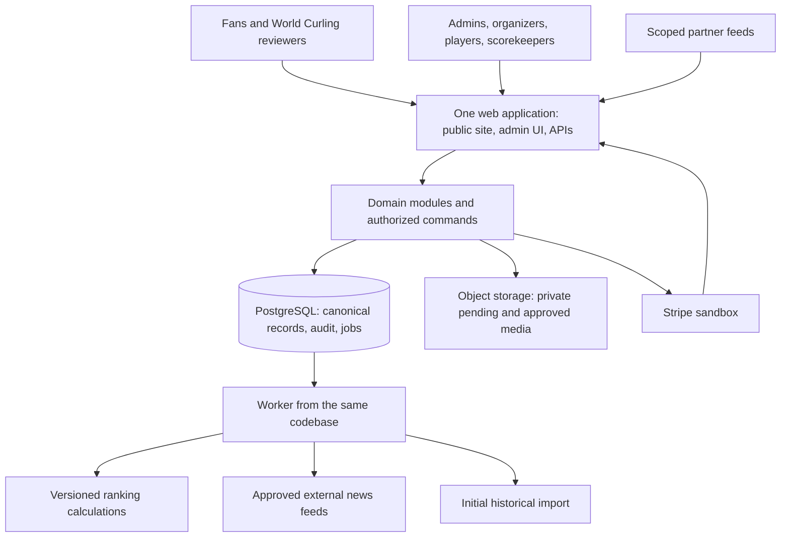

# World Curling Platform implementation plan

Consolidated 2026-11-07. Product direction through Q62 and subsequent frontend/unit-testing clarifications are recorded in the canonical local parent specification. Component choices below are documented defaults under the user's delegated stack/hosting preference. This plan is supporting material for ticket decomposition; no application, migrations, resources, or deployment have been created.

## Delivery target

Deliver the [initial offer](initial-offer.md) as a hosted, usable demonstration on the public domain the user will purchase. World Curling reviewers should be able to explore the fan site and the seven recorded workflows using scoped demonstration accounts. PostgreSQL holds canonical records. Payments use a central sandbox account. Clearly distinguish historical imports from fictional demonstrations and approved ranking publications from draft calculations.

The [frontend specification](frontend-specification.md) is part of acceptance: a working scores-first public site and role-specific screens connected to domain APIs, with verified navigation, responsive layouts, live states, and meaningful content. Visual polish and complete interactions are delivery work; a static facade or a passing build is insufficient.

The first calculated ruleset is WCTRS 2026-27. Historical ranking publications remain available without claiming that every earlier season was recalculated. A fully specified test dataset proves calculation reproducibility independently of gaps in imported history.

## Technical defaults

| Concern | Default | Purpose and boundary |
|---|---|---|
| Language/application | TypeScript, Next.js on Node.js | One web application for the fan site, self-service/admin UI, and versioned HTTP APIs. Server deployment, not static export. |
| Database | PostgreSQL | Authoritative sport, approval, payment, audit, import, and ranking records with relational constraints and transactions. |
| Database access | Drizzle with reviewed SQL migrations | Typed access without abandoning SQL constraints, custom indexes, or deferred validation. |
| Background work | pg-boss and a worker from the same codebase | Durable imports, ranking calculations, news polling, and retryable integration work using PostgreSQL. |
| Authentication | Better Auth, email/password and database sessions | Public account creation, verified email, account recovery, and shared authentication across application routes. Configure an actual email-delivery provider for hosting. |
| Authorization | Application-owned roles/scopes | Authentication never implies player ownership, organizer authority, global administration, or partner write access. |
| Payments | Stripe-hosted Checkout in a sandbox | Central collection, webhook-confirmed payment state, and explicit full/partial refunds. No live payments or organizer payout distribution in this offer. |
| Media | S3-compatible object-storage adapter; Cloudflare R2 as hosted default | Durable images outside application disks; pending uploads private, public profile references approved only after review. |
| Hosting | Render web process, worker, and managed PostgreSQL | Simple persistent deployment layout with domain/TLS support. Choose service sizes during provisioning using a current quote. |
| UI | Responsive custom public and administration screens | Homepage event score cards, usable bracket/list views, and mobile score entry. One design system; no separate generic CMS. |
| Live delivery | Initially poll public/read endpoints | Working default: active score views refresh about every 5-10 seconds, with visible last-update/connection state. Treat this as a demo target to measure, not an untested service guarantee. |
| Local setup | Containerized PostgreSQL and media/email development adapters | Repeatable local configuration and isolated fixtures. Pin compatible supported versions and commit lockfiles during implementation. |

These defaults avoid a second backend language, a separate queue datastore, and independently deployed domain services. Providers remain behind adapters for payment, media, and email. Routine library/UI choices can be made during implementation without reopening the product interview.

### Verified primary documentation

- [Next.js deployment](https://nextjs.org/docs/app/getting-started/deploying) supports Node/Docker hosting; [standalone output](https://nextjs.org/docs/app/api-reference/config/next-config-js/output) is the container packaging option.
- [Drizzle migrations](https://orm.drizzle.team/docs/migrations) and [custom migrations](https://orm.drizzle.team/docs/kit-custom-migrations) support reviewable application DDL.
- Better Auth provides [Next.js integration](https://better-auth.com/docs/integrations/next), a [Drizzle adapter](https://better-auth.com/docs/adapters/drizzle), and [email/password verification/recovery callbacks](https://better-auth.com/docs/authentication/email-password). Email delivery is a configured integration, not an included mailbox.
- [pg-boss](https://github.com/timgit/pg-boss) and its [transaction adapters](https://pgboss.io/api/adapters) support PostgreSQL-backed jobs alongside the application. Verify the selected package/runtime/database version combination when installing.
- Render supports [web services](https://render.com/docs/web-services), [workers](https://render.com/docs/background-workers), [PostgreSQL connections](https://render.com/docs/postgresql-creating-connecting), and [custom domains](https://render.com/docs/custom-domains). Store media externally because service files are [ephemeral](https://render.com/docs/disks).
- R2 supports [private presigned uploads/downloads](https://developers.cloudflare.com/r2/api/s3/presigned-urls/); these signed requests use its S3 API hostname, and browser uploads require appropriate bucket CORS.
- Stripe supports [hosted Checkout](https://docs.stripe.com/payments/checkout), [sandboxes](https://docs.stripe.com/sandboxes), [server-confirmed fulfillment](https://docs.stripe.com/checkout/fulfillment), [signed webhooks](https://docs.stripe.com/events/manage-webhook-endpoints), [idempotency](https://docs.stripe.com/api/idempotent_requests), and [full/partial refunds](https://docs.stripe.com/refunds).

Documentation compatibility has been checked; integration behavior is not yet tested. The Render deployment skill informed this proposed layout. Its deployment prerequisites apply when deploying, not as reasons to delay writing this plan.

## Application shape

Deploy the web and worker as two processes of one application, not as separate domain owners. Coordinate database migrations across both. The database is the source of truth; a public projection/cache can be rebuilt from its recorded source versions.

Proposed source organization: `src/modules/{identity,registration,competition,ranking,governance,integration,payments,media,news,public}`, thin web/API adapters, and `src/worker`. A single root glossary is sufficient; no separate code-context directory structure is imposed before implementation.

## Domain and API boundaries

| Module | Owns | Important commands/reads |
|---|---|---|
| Identity | People, core-composition teams, season registrations, scoped human roles | Resolve/create team, maintain official roster, correct identity, assign roles |
| Governance | Event/profile reviews, actor attribution, publication decisions, audit | Approve event/profile claim/photo, publish ranking list, inspect changes |
| Registration | Series/editions/divisions, applications, entries, capacity and event lineups | Submit/approve edition, open entries, register/manual entry, withdraw, invite waitlist |
| Competition | Templates/stages/draws/sessions/games, scores, game lineups, result/finalization versions | Publish draw, assign sheet/time, score, confirm/correct result, organizer bracket edit, finalize division |
| Ranking | Rulesets, frozen source inputs, entitlements, assessments/awards, runs/contributions | Calculate 2026-27 WCTRS, show comparison/issues, approve dated publication |
| Integration | Batch imports/provenance/mappings, partner credentials/scopes, inbox/outbox | Approve import batch, process feed update, select/take over scoring source |
| Payments | Charges, reservations, payment attempts/events, fee exceptions and refunds | Create test checkout, consume signed event, expire reservation, record external payment, issue authorized refund |
| Media/news | Private photo requests and approved assets; linked external news | Upload/request/review photo, poll approved feeds, hide item |
| Public | Restricted read models and analytics | Current-draw cards, brackets/standings, entry/team/player/event pages, approved rankings/history, analytics |

Use `/api/v1/public/...` for public reads and authenticated command endpoints under `/api/v1/...`; partner credentials authorize only assigned actions/scopes. Browser UI commands call the same domain services and permission checks as partner/API commands. Public APIs never serialize entire database entities or review/audit payloads.

Working host layout: `https://<user-domain>/` for the public site, `/admin` for administrative/self-service views, and `/api/v1` for APIs. The logical administrative boundary is permission-based; an admin subdomain can be configured later without splitting domain ownership.

### Consistent writes and audit

Every authoritative command validates its actor and scope, current record version, and applicable sport rules. The canonical change, audit record, and relevant outbox/job work commit together. Use a transactional job adapter or a transactional outbox followed by idempotent enqueueing; do not claim an atomic database/provider transaction.

Use durable idempotency for scoring/feed/payment commands. Reject conflicting stale edits and show current data; do not silently overwrite. Worker handlers tolerate retries and shutdown, store failure details, and permit authorized retry. External storage/payment/email calls have recorded request/status transitions and retry handling.

Human scorekeepers and explicitly authorized partner feeds can confirm/correct their games without administrator approval. Organizers may adjust affected brackets with recorded history. Preserved finalized snapshots and ranking publications cannot silently change when mutable current scores change.

Working offer calculation trigger: a new/revised division finalization queues its assessment/award work and directly affected draft ranking runs for the applicable ruleset dates/cutoffs. Administrators can recalculate a draft on demand, including at dated rule checkpoints. Transitive reassessment of later events is deferred under the canonical scope refinement; retain original assessment inputs and flag unresolved wider impacts. Neither job completion nor organizer finalization publishes an official list; publication is the explicit World Curling approval action.

### Authentication and media defaults

Anyone may create an account. A profile claim is a separate administrator-approved link. Organizer/scorekeeper/representative permissions are explicitly assigned; a linked player profile alone grants no event administration rights. Use verified-email sessions, secure cookie defaults, recovery, rate limits on credential/write routes, and server-side scope checks.

Linked player fields are short biography and handedness plus photo submission. Pending/rejected assets stay private; the current approved photo remains public until approval changes the reference. Validate image type/size, generate safe display variants, and serve public profile images through an approved-asset path. Keep private contact/authentication fields out of public responses and generic audit JSON.

Partner credentials are organization/event/action-scoped, revocable and rotatable, displayed only when issued, and stored as verifiers rather than recoverable raw secrets. The audit actor identifies the client and request. One manual source or approved feed controls a game's scoring at a time, with explicit authorized takeover.

### Entry and payment defaults

Keep entry acceptance, payment status, roster readiness, and ranking eligibility separate. Capacity reservations are transactional and expiring; a payment arriving after reservation expiry follows a visible exception path instead of overbooking. Staff manually invite waitlisted teams and decide refunds.

Use one central Stripe sandbox for the offer. Store money in currency minor units with the currency code, not a universal two-decimal assumption. Confirm payment from verified server events/provider state, not the success redirect. Deduplicate provider events and use idempotent outbound requests. Record refunds as transactions, including their provider status and remaining refundable amount. Record external payments separately; a staff waiver changes the amount due rather than impersonating a successful online charge.

Real collection/distribution arrangements remain outside the offer's settled financial model. Do not activate live payment keys or organizer payouts as part of the demo.

## Implementation stages and proof

The canonical specification's [seven-workflow acceptance map and approved exceptional-scenario deferrals](../../.scratch/world-curling-platform/spec.md#initial-offer-acceptance-seven-demonstration-workflows) govern these stages. They are the offer's delivery structure; the stages below describe sequencing only. Do not require elaborate recovery handling for all audit scenarios before an ordinary workflow can be completed. Accepted P-01/P-05 explicitly bound coverage/metrics; other supporting capabilities remain included. All five core decisions are settled, with a 16-team four-player triple-knockout main demonstration. This plan update authorizes no implementation or provisioning.

| Stage | Deliverable | Exit evidence |
|---|---|---|
| 1. Foundation | Repository/app skeleton, migration tooling, core identity/roles, local seed personas, base visual shell | Repeatable local setup; authentication/profile links; cross-event permission isolation; empty public/admin views |
| 2. First scoring slice | Seeded event/division/entries, mobile score entry, confirmation/correction, homepage current-draw cards | One scorekeeper update visible to a fan, correct saved/unsent state, auditable correction, denied out-of-scope write |
| 3. Competition templates | Relational draw generation, organizer scheduling/bracket edits, common format fixtures | End-to-end triple-knockout path and template-level progression checks; sheet/player conflicts visible; manually selected qualifiers |
| 4. Registration/payment | Event applications/delegation, self/manual entries, automatic team reuse, capacities, sandbox checkout/refunds | Organizer/admin workflow plus paid/failed/expired/waived entry examples; no duplicate payments or capacity overbooking |
| 5. Player and partner workflows | Profile claim/photo approval, biography/handedness, partner credential scopes/source selection | Old photo stays public while pending; approved image replaces it; partner confirms/corrects assigned game only |
| 6. Ranking engine | Versioned 2026-27 WCTRS calculations, entitlements, assessments, immutable input/output runs, approval/history UI | Independent rule fixtures; deterministic replay; event contribution explanations; publication replacement after correction |
| 7. Historical import | Crawler export/translation, staging, provenance/mappings, administrator batch approval | Representative batch reviewed; import rerun adds no duplicates; final-score-only history works; unresolved identities remain visible |
| 8. Public depth | Search, event/team/player/history pages, favorites, news aggregation, four analytics groups | Mobile fan walkthrough; filters/sample coverage visible; approved rankings only; no hidden private fields in public API |
| 9. Hosted offer | Render configuration, user domain/TLS, repeatable demo scenarios, recordings and operator/setup notes | Hosted smoke checks with scoped accounts; seven recorded workflows plus partner example; documented implemented versus deferred coverage |

Stages are implementation order, not a reduced final scope. Stage 2 supplies early feedback from a real database-to-screen workflow; later stages still deliver the agreed complete offer. Start import tooling discovery early enough to inform identity fixtures while keeping historical ingestion independent of live operation.

### Offer proof sequence

| Acceptance | Primary stages and proof |
|---|---|
| D-01 fan follows triple knockout | Stages 2/3/8: 16-team four-player event, persistent scoring-to-public path, stored A/B/C routing, mobile bracket/list and connected navigation. |
| D-02 administrator approves event | Stages 1/4: responsible authority, admitted calendar entry, distinct registration/ranking states and denied unrelated approval. |
| D-03 volunteer scores/confirms/corrects | Stages 1/2/3: mobile scoring, ordinary correction, audit, duplicate/stale-write protection and honest save status. |
| D-04 next-year event and entries | Stage 4: self/manual entry, team identity, normal sandbox payments, fee exception, expiry/withdrawal and sequential refunds. |
| D-05 profile and photo approval | Stage 5: separate claim authority, private pending photo and immutable approved asset replacement. |
| D-06 administrator audits rankings | Stages 6/7/8: sourced historical observations, independent calculation fixtures, comparison/contributions and reproducible approved list. |
| D-07 finalize and replace publication | Stage 6: division snapshot, explicit ranking approval, ordinary result correction, revised finalization and direct replacement with preserved history. |

Stage 9 packages all seven proofs plus the sequential partner example; it does not replace working workflows with recordings. Retain meaningful unit, PostgreSQL, API and browser checks and report planned/implemented/verified coverage. Use the canonical minimum safeguards when deferring exceptional recovery automation.

## Coverage and acceptance

The coverage matrix must list each supported discipline/category, competition format, and ranking list with `planned`, `implemented`, and `verified` states. All are planned today; no format or calculation is claimed tested. Accepted P-01 limits offer support to men's/women's four-player and mixed doubles, with a 16-team four-player triple-knockout main demonstration and one documented configuration per other accepted format family. Additional disciplines (including wheelchair and four-player mixed), age-specific variants and unusual stage combinations are deferred. Record the concrete named configurations during bounded decomposition; do not expand to universal coverage. Eligibility categories do not create invented ranking systems.

Competition fixtures must cover the 16-team main demonstration and one documented configuration per other accepted format family: round robin/pools, single/double knockout, Page playoffs and Swiss/Schenkel. Bound any ordinary stage combination explicitly during decomposition; unusual combinations and exhaustive parameter permutations are deferred. Prove winner/loser routing, byes, seed/qualifier selection and organizer overrides on deterministic fixtures. Automated playoff-qualification tiebreaks remain excluded; provide manual qualifier/seed inputs. A general freehand format editor remains excluded.

Ranking fixtures must cover in-scope men's/women's overall and series lists plus mixed doubles pair/individual calculations, effective dates/cutoffs, eligible events, exclusions, tie ordering required by ranking rules, roster entitlements, transitions/carryover, adjustments, rounding, and imported starting inputs. Excluding competition-qualification tiebreak automation does not exclude WCTRS ranking tie rules. Use independently worked expected values, not tests that merely repeat implementation code.

Preserve published-as-seen history separately from later corrected-effective-date history. Ranking replay evidence includes ruleset, engine revision, input contents, exact arithmetic/rounding policy, contributions, and output digest. Source seeds may make forward calculations reproducible without pretending that earlier seasons were fully reconstructed.

The seven [demonstration walkthroughs](initial-offer.md#seven-demonstration-walkthroughs) are the user acceptance script. Add meaningful database/integration checks for transactions, idempotency, concurrency, permission boundaries, media visibility, and payment events; use browser checks for those end-to-end flows. Record actual tested coverage at delivery.

Distinguish basic integrity checks from deferred recovery workflows. Last-place capacity, safe retries, no excess refunds (including pending amounts), current source authority, coherent snapshots, and immutable published history remain required. Full downstream played-game repair, transitive ranking cascades, collision-consolidation tools, field-level import reconciliation, queue-draining handoffs, and automated exceptional payment settlement are not exit gates. D-03/D-07 use corrections without started dependent games. D-07 demonstrates a direct replacement publication, not retrospective reassessment of other events. P-05 bounds named analytics metrics across the four accepted groups.

The user explicitly requires substantial unit testing as far as reasonably possible. Test the public domain interfaces for ranking/eligibility arithmetic, draw/progression, core identity, score validation, entry/payment/capacity policy, permission scopes, and analytics/projection rules. Use independent expected values, normal and meaningful boundary/failure cases, and coverage reports to find gaps. Complement units with real PostgreSQL and browser tests; neither extensive mocks nor an arbitrary percentage establishes end-to-end correctness.

Apply the frontend specification's browser/screenshot checks at representative mobile, tablet, and desktop widths. Verify that controls, links, filters, and charts perform their advertised task with actual API data. Keep copy limited to useful curling content, labels, and honest interface states.

## Initial import and ranking research

For the offer, pin the reviewed source batch, preserve provenance/missingness and repeat an unchanged import safely. If new source evidence conflicts with curated canonical data, retain the evidence/issue and leave the curated values unchanged; defer elaborate reconciliation. Detect identity-correction collisions and leave them unapplied rather than attempting a partial multi-entity merge. Staff operate dated ranking calculations using the existing on-demand flow; an automated checkpoint scheduler and transitive correction engine are not prerequisites. Record dated rules and independent expected fixtures before claiming calculated correctness. Apply accepted P-02/P-03/P-04: World Curling-granted team-season representation, five regular rotating members as core, and no calculated publication with unresolved required inputs or ranking eligibility. Informational warnings irrelevant to the calculation may be acknowledged; no configurable exception engine is required.

Read a consistent crawler archive/export through a one-time translation tool; preserve fully scoped external IDs, source claims, and extraction provenance. Do not run the crawler as a platform dependency. Stream/stage data and validate a representative batch before broader loading. Administrator batch approval admits historical events/results with truthful imported-source status; it does not fabricate scorekeeper certification or full WCTRS reproducibility.

Resolve people before deriving known core-composition identities. Preserve incomplete event entries, unlinked ranking labels, unknown hammer, unknown participation, and final-score-only games. Keep calculated ranking publications and imported historical observations distinguishable. Do not infer a permanent roster from every player who appeared in one game.

Two known rule clarifications remain in [official-rules-evidence.md](official-rules-evidence.md): the mixed doubles page's eight/six discrepancy and allocation rounding examples. Evidence supports six counting events, but record an explicit, sourced ruleset interpretation rather than claiming an official erratum. The allocation engine needs a documented exact-share/rounding policy; do not silently allocate a residual to a player. These are bounded rule-validation work items, not reasons to ask the user to guess sporting facts.

## Hosted review and delivery boundary

Provision the web, persistent worker, and PostgreSQL together; use internal database connections, external media, configured email, and secret/environment management. Pin migrations and worker/job schema management to the release. Expose a health endpoint and record job failures/request correlation so the demo can be operated and debugged.

The user buys the domain; deployment later connects its DNS and TLS. Repository/hosting access and service/email/payment/media credentials are implementation-time inputs. Provider account creation, paid provisioning, DNS changes, and publishing were not performed during planning.

Host historical review data separately from resettable synthetic scenarios, preferably in distinct environments/databases. A clearly labelled demo can have public fan pages while administrative actions require scoped reviewer accounts. Keep sandbox payments and demonstration roles separate from real official administration. Supply recordings, operator/setup notes, API documentation, and a comparison of delivered coverage to this plan.

Secure backup/recovery work and restore demonstrations remain explicitly excluded from initial-offer acceptance. Managed providers may supply built-in features, but this plan does not claim an independently verified recovery design. Preserve the other deferrals in the scope document; a public demonstration is not a declaration of official World Curling production launch.
